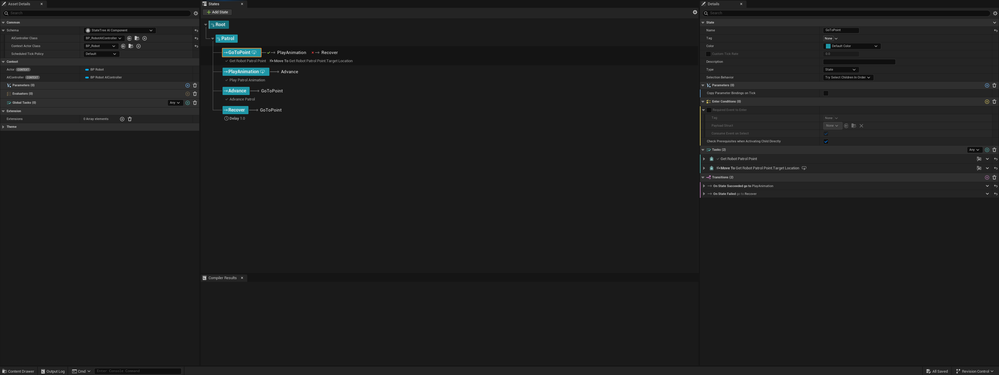
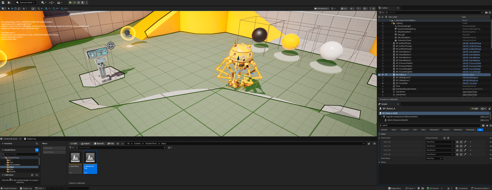
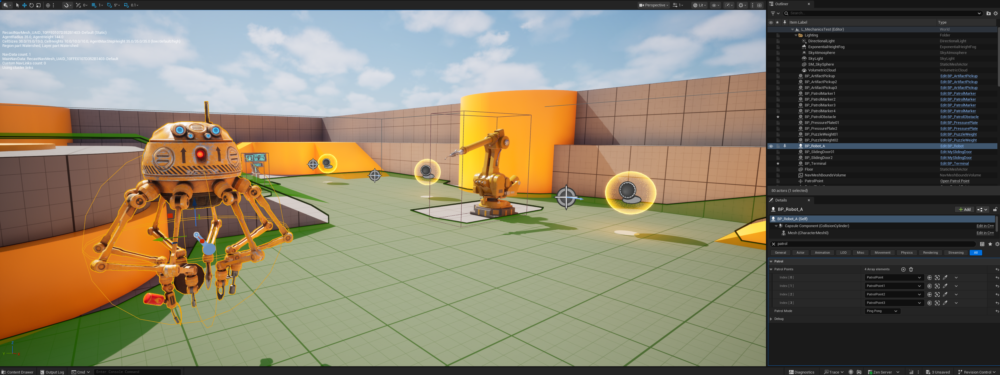

# State Tree NPC Patrol — Unreal Engine C++

A robot NPC patrol system developed for **A Soul in Three** as Assignment 12 of an Unreal Engine C++ course. Robots follow patrol points placed in the editor, in either a looping or a ping-pong route. Points can also make a robot stop and play an animation. The route logic lives in a C++ component, and a State Tree drives the robot through custom C++ tasks.

This repository presents the C++ source files, editor screenshots, and a gameplay demonstration. The ten `.h` and `.cpp` files are copied unchanged from the game project's `Source/ASoulInThree` module.

## Demo Video

[▶ Watch the demo on YouTube](https://youtu.be/a-cTkMQ-XLg)

## Editor and Gameplay Preview

### Robot Patrol State Tree

The `ST_RobotPatrol` State Tree uses the StateTree AI Component schema with `BP_Robot` as its context actor and `BP_RobotAIController` as its AI controller. The `GoToPoint` state runs the custom *Get Robot Patrol Point* task next to the built-in *Move To* task, whose destination is bound to the task's `TargetLocation` output.



### Patrol Route on a Placed Robot

Each placed robot has its own route. Patrol points and the patrol mode are set per instance in the Details panel. The NavMesh debug overlay shows the walkable area.



### Maintenance Robot in the Test Level

The robot uses a hovering maintenance robot model. Patrol points are visible as editor markers around the level.



## Assignment Requirements

| Requirement | Implementation |
|---|---|
| NPC patrol using a Behavior Tree or State Tree | `ST_RobotPatrol` State Tree run by `UStateTreeAIComponent` on `ARobotAIController` |
| Patrol points defined in the editor | `APatrolPoint` actors (based on `ATargetPoint`) assigned per robot in the Details panel |
| A C++ component | [`UPatrolRouteComponent`](PatrolRouteComponent.h) stores the route, the mode, and the current point |
| A task in Blueprints or C++ | Three C++ State Tree tasks in [`RobotStateTreeTasks.h`](RobotStateTreeTasks.h) |
| Additional task: two patrol modes, cyclic and reversing | `EPatrolMode::Loop` and `EPatrolMode::PingPong` |

## Features

- Patrol points placed in the level and assigned per robot instance.
- **Loop** mode: after the last point, the robot continues from the first one.
- **Ping Pong** mode: the robot reverses direction at both ends of the route.
- Optional per-point animation: a patrol point can carry an animation that the robot plays once on arrival, then returns to its looping idle animation.
- Recovery after a failed move: when the path is blocked, the robot waits and retries instead of stopping the State Tree.
- Robots block the player but pass through physics-based puzzle objects.
- Empty or destroyed patrol point entries are removed on `BeginPlay`.
- Routes with fewer than two points are handled safely.
- Optional verbose logging of route progress for debugging.

## C++ Implementation

The implementation follows one rule: **the component knows, the tasks ask**. `UPatrolRouteComponent` holds all route state and decides which point comes next. The State Tree tasks only read the current point or ask the component to advance. Both patrol modes therefore use the same State Tree.

### Patrol Route Component

[`UPatrolRouteComponent`](PatrolRouteComponent.cpp) stores an ordered array of patrol point actors, the selected `EPatrolMode`, the current index, and the Ping Pong direction. The component does not tick; it only answers queries from the AI.

- `GetCurrentPoint()` returns the actor at the current index, or `nullptr` when the index or actor is invalid.
- `GetCurrentPointLocation()` writes the current point's world location and returns `false` when no valid point exists.
- `AdvanceToNextPoint()` moves to the next point. Loop wraps the index with the modulo operator. Ping Pong checks the next index first and reverses `Direction` before stepping outside the array. Routes with fewer than two points stay unchanged, which also prevents a modulo by zero.

With four points and a start at index 0, the component produces:

| Mode | Index sequence |
|---|---|
| Loop | 1, 2, 3, 0, 1, 2, 3, 0 |
| Ping Pong | 1, 2, 3, 2, 1, 0, 1, 2 |

On `BeginPlay`, invalid entries are removed with `RemoveAll()`, and the index and direction are reset.

### Patrol Point

[`APatrolPoint`](PatrolPoint.h) extends `ATargetPoint` with an optional, instance-editable `UAnimSequence`. Routes can still contain ordinary actors; only `APatrolPoint` actors with an assigned animation make the robot stop.

### Robot and AI Controller

[`ARobotNPC`](RobotNPC.cpp) is an `ACharacter` that owns the patrol route component. It is possessed automatically by AI when placed or spawned, rotates towards its movement direction, and walks at a configurable speed. Its capsule ignores the Physics Body channel, so puzzle weights pass through the robot while the player is still blocked.

[`ARobotAIController`](RobotAIController.cpp) creates a `UStateTreeAIComponent` with automatic start disabled. The State Tree starts in `OnPossess()` only when the possessed pawn is an `ARobotNPC`; any other pawn logs a warning. `OnUnPossess()` stops the State Tree before releasing the pawn.

### State Tree Tasks

The tasks are implemented as `USTRUCT` types derived from `FStateTreeTaskCommonBase`, each with its own instance data struct. The robot is bound automatically from the State Tree context.

| Task | Behavior | Result |
|---|---|---|
| **Get Robot Patrol Point** | Reads the current point's location into the `TargetLocation` output, which the built-in *Move To* task uses as its destination | Returns `Running`, so *Move To* decides when the state completes |
| **Play Patrol Animation** | Plays the current point's animation on the robot's skeletal mesh, waits for its duration (including the sequence `RateScale`), then restores the idle animation in `ExitState` | Returns `Succeeded` at once when the point has no animation |
| **Advance Patrol** | Calls `AdvanceToNextPoint()` on the route | Returns `Succeeded` immediately |

Returning `Running` from *Get Robot Patrol Point* is deliberate. If the task succeeded immediately, the state could complete before *Move To* started moving the robot.

The idle animation is restored only when an action animation was actually played. Points without an animation therefore do not restart the idle loop from its first frame.

## State Tree Setup

```
Root
 └─ Patrol
     ├─ GoToPoint      Get Robot Patrol Point + Move To (Destination ← TargetLocation)
     │                 succeeded → PlayAnimation, failed → Recover
     ├─ PlayAnimation  Play Patrol Animation              → Advance
     ├─ Advance        Advance Patrol                     → GoToPoint
     └─ Recover        Delay 1.0 s                        → GoToPoint
```

Without the `Recover` state, a failed move had no transition, and the State Tree stopped, which left the robot frozen. With it, a blocked robot waits one second and tries again.

## Demonstration Flow

The video shows:

1. The patrol route component on a placed robot, with patrol points and the patrol mode in the Details panel.
2. Patrol points with assigned animations.
3. The `ST_RobotPatrol` State Tree and its states.
4. Robots patrolling in Loop and Ping Pong modes, playing animations at selected points.
5. A blocked path: the robot waits in `Recover` and continues once the path is clear.

Route progress can be logged during play by entering `log LogPatrol Verbose` in the console.

## Repository Contents

All C++ files are located in the repository root.

| Files | Responsibility |
|---|---|
| [`PatrolRouteComponent.h`](PatrolRouteComponent.h), [`PatrolRouteComponent.cpp`](PatrolRouteComponent.cpp) | Patrol route data, Loop and Ping Pong logic, current point queries |
| [`PatrolPoint.h`](PatrolPoint.h), [`PatrolPoint.cpp`](PatrolPoint.cpp) | Patrol point with an optional animation |
| [`RobotNPC.h`](RobotNPC.h), [`RobotNPC.cpp`](RobotNPC.cpp) | Robot character, AI possession, collision, and movement settings |
| [`RobotAIController.h`](RobotAIController.h), [`RobotAIController.cpp`](RobotAIController.cpp) | AI controller that starts and stops the State Tree |
| [`RobotStateTreeTasks.h`](RobotStateTreeTasks.h), [`RobotStateTreeTasks.cpp`](RobotStateTreeTasks.cpp) | Get Robot Patrol Point, Play Patrol Animation, and Advance Patrol tasks |
| [`screenshots/`](screenshots/) | State Tree and editor screenshots |

## Integration Notes

This is a **source-code and visual showcase**, not a complete runnable Unreal Engine project. It contains every C++ file used by the patrol system, but not the `.uproject`, module build files, maps, the State Tree asset, Blueprints, or the robot model.

In a host project:

- Copy the ten source files into the game module's source folder.
- Replace `ASOULINTHREE_API` with the appropriate module export macro.
- Add the `AIModule`, `StateTreeModule`, and `GameplayStateTreeModule` modules to the project's `Build.cs`, and enable the StateTree and GameplayStateTree plugins.
- Create a Blueprint of `ARobotAIController` and a Blueprint of `ARobotNPC` with a skeletal mesh, then set the robot's AI Controller Class to the controller Blueprint.
- Create a State Tree with the StateTree AI Component schema, set its context actor and AI controller classes to these Blueprints, build the states shown above, and assign the asset to the controller's State Tree component.
- Set the *Idle Animation* parameter on the Play Patrol Animation task; otherwise the robot keeps the last frame of an action animation.
- Place a Nav Mesh Bounds Volume that covers every patrol point.
- Place `APatrolPoint` actors and assign them to each robot's Patrol Points array.

## Future Improvements

- Finish the Play Patrol Animation task when the animation reports completion, rather than by a timer.
- Add a Talk state: the player interacts with a robot, which stops, turns towards the player, speaks, and returns to its patrol.
- Optionally save robot route progress with the game's save system.

## Asset Credits

The robot uses the **Maintenance Orb** model and animations from Fab. External assets are not included in this repository.
